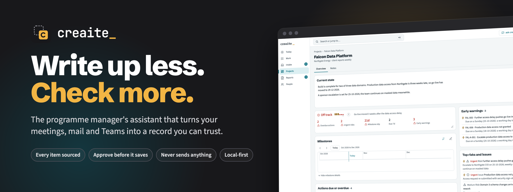
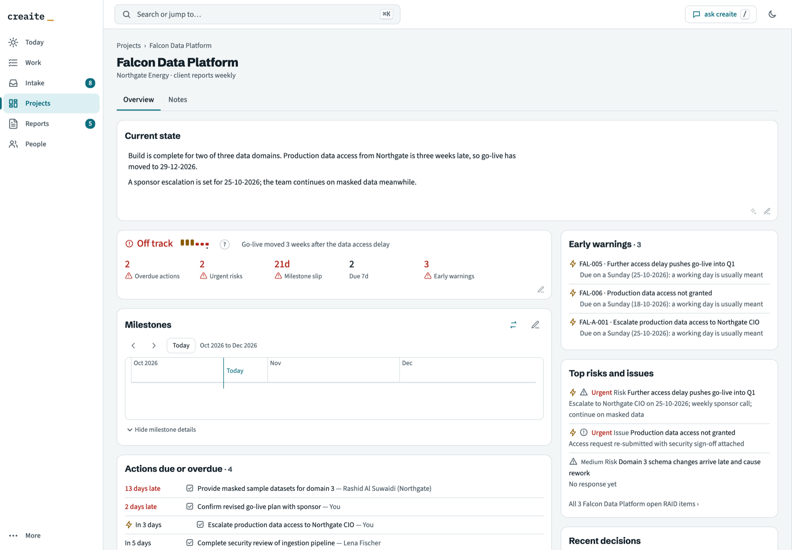
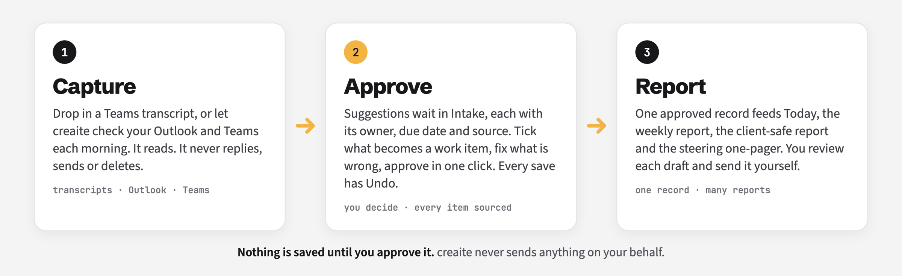
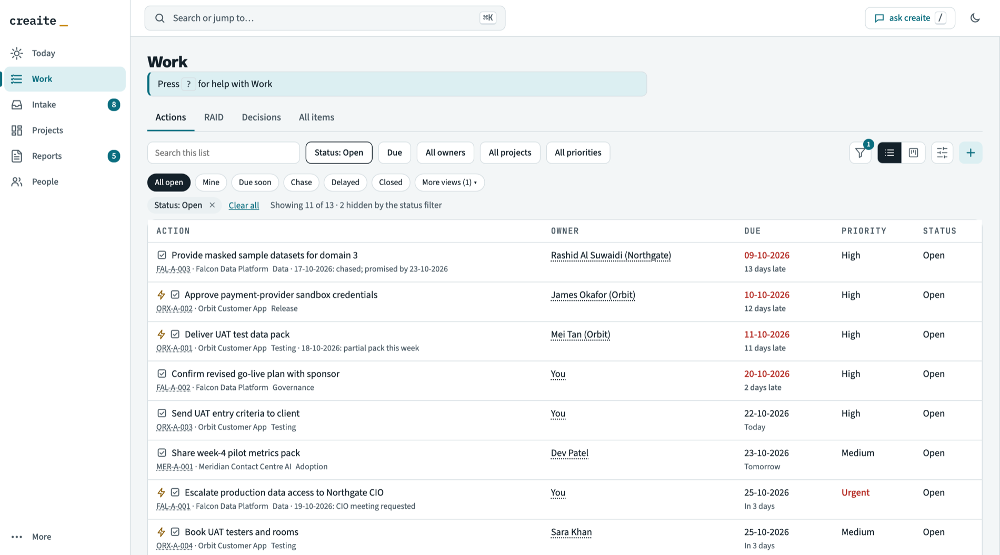
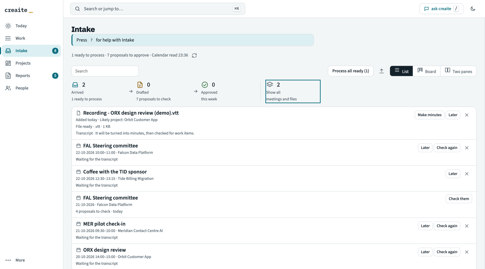

<p align="center">
  
</p>

<p align="center"><i>Every action, decision and risk comes with its source, and nothing is saved until you approve it.</i></p>

<p align="center">
  
  
  
</p>

---

## The meeting ends. The admin begins.

You leave the steering committee with six new actions, a decision nobody wrote down and a risk someone mentioned in passing. By Friday you are rebuilding the same status report from memory, chasing owners, and wondering which tracker is the real one.

**creaite does that part.** It reads your Teams transcripts, Outlook and Teams, drafts the minutes, and proposes the actions, decisions, risks and issues that came out of them, each with an owner, a due date and the source it came from. You check, tick and approve. creaite keeps one record and writes everything else from it: Today, the weekly report, the client report, the steering one-pager.

<p align="center">
  <br>
  <sub>A project at a glance: current state, health with the evidence behind it, early warnings, milestones and what is due. Sample data.</sub>
</p>

## How it works

<p align="center">
  
</p>

## Built so you can trust it

AI that writes to your record unchecked is how a status goes quietly wrong. creaite is built the other way round.

| | |
|---|---|
| **Nothing changes until you approve it** | Suggestions wait. Routine ones can be approved together; new decisions, new risks and health changes always need your eye. |
| **Every item has a source** | Each action, decision, risk and issue cites the meeting, email or chat it came from. In the minutes, hover a row to see the transcript line behind it. |
| **Every change can be undone** | Every save has Undo, and changes to your files are backed up first. |
| **It never sends anything** | No mail, no Teams messages, no reports. Microsoft 365 is read-only for creaite. Drafts are yours to send. |
| **Status is worked out, not guessed** | Health, overdue and slipping are calculated from your own record by ordinary code, not by a model's opinion. |
| **It tells you its limits** | It can misread an owner or a date. That is why you approve each item. |

## Everything it does for you

| | |
|---|---|
| **Minutes you can edit in place** | One clean document with a Track column: tick a line to make it a work item, cross it to remove it, leave it to keep it in the minutes only. Edit words, owners, dates and priorities in the row, hover a row to see the transcript line it came from, then approve in one click. Export as Word, PDF or HTML, or draft the follow-up email. |
| **Today** | The meetings in your day, what is overdue or due soon, decisions waiting on you or on others, what you owe and are owed, and milestones that are slipping, with the open work behind each. |
| **Mail and Teams check** | Follow-ups and commitments in your Outlook and Teams, offered as suggestions. What people you follow send you shows up on Today, so nothing from them is missed. |
| **Reports without the Friday scramble** | A weekly report per project with health and the reasons, a client-safe report that shows only what you have flagged as client-visible, and a one-page steering summary. All drafted as Word documents. |
| **Meeting prep in a minute** | The open items that matter, the latest reporting, suggested questions, and notes with sources. |
| **Ask creaite** | Ask in plain English ("what is blocking go-live?", "make a document of open risks") and get an answer from your own record, with where it came from. |
| **Work, People, Projects** | Actions, risks, issues and decisions across every programme; one People page for who owns what; health with its evidence. Single keys jump between pages: T Today, P Projects, W Work, I Intake, F Files, A Activity, R Reports, S Settings, E People. |

<table>
  <tr>
    <td width="50%"><br><sub>Work: every open action across your programmes. Sample data.</sub></td>
    <td width="50%"><br><sub>Intake: everything that arrives and waits for you. Sample data.</sub></td>
  </tr>
</table>

## A week with creaite

- **Monday to Thursday.** Meetings happen. You open Today, see what needs you, and approve the suggestions from yesterday's meetings in a few minutes.
- **Before a meeting.** Press Prep: the open items, the latest status and questions to raise.
- **Friday.** The weekly report is already drafted per project. Review, adjust, file.
- **Steering committee.** One click for the one-pager, from the same record.

## New in 2.6

2.6.3 is out; every item below is in it.

- **Approving is safer.** A button can no longer approve a different item when the list changes behind an open page, and Approve minutes skips what you already approved and says which.
- **A minutes editor that says what it does.** Track is three icons (track, minutes only, drop), Approve minutes says how much it tracks, and an attention strip counts what still needs an owner or a date.
- **Minutes you can share.** HTML and PDF carry the firm's look, the shareable version leaves out sensitive items, and the follow-up email is shareable by default.
- **Today** shows nothing twice and always looks to the Friday of next week; a Week ahead milestone shows how many open work items it depends on.
- **One Intake.** Review and Intake are one page, with List, Board and Two panes views, and **Approve routine** for the routine suggestions.
- **Work items** with marks, compact rows and keys, an avatar menu, and a switch to start creaite when you sign in.
- **Minutes you can file and export.** Approve minutes asks where they will be filed and what they will be called, and numbers the name if it is taken. Export offers Shareable and Internal versions, and the Word minutes carry the project name, date and attendees.
- **Intake is easier to work through.** Tick several meetings and act on them from one right-click menu, group by day, project or state, and see each meeting's items nested beneath it.
- **Cheaper chats with ask creaite.** Each question starts fresh by default, and a long chat offers a fresh start with a short summary.
- **Email drafts in Outlook.** An opt-in setting, off by default, puts a draft in your Outlook Drafts folder. It never sends anything.
- **Your profile** in Settings, and an Undo for minutes you set aside.

The plain-English notes for every release are in [`dev/release-notes/`](dev/release-notes/) ([2.6.0](dev/release-notes/2.6.0-plain.md), [2.6.1](dev/release-notes/2.6.1-plain.md), [2.6.2](dev/release-notes/2.6.2-plain.md), [2.6.3](dev/release-notes/2.6.3-plain.md)). This README is refreshed with each release.

## Your data stays local

**Local-first: your data lives in your own tools, on your Mac and your company's OneDrive.** creaite adds no cloud of its own.

Claude reads the content it works on, under your own Claude plan. Confidential material can be kept out of reports and prep pages.

## Questions you will have

**Will it get things wrong?** Yes, sometimes: an owner, a date, a risk that was only mentioned. That is why nothing is saved until you approve it, why every item shows its source, and why every save can be undone.

**Does it send anything on my behalf?** No. It does not send mail or Teams messages and does not publish reports.

**Where does my data go?** The record stays on your Mac, backed up daily to your company OneDrive. Claude reads the content it works on, under your own Claude plan. creaite has no servers of its own.

**Can I use it at work?** It runs under your own Claude plan and your own Microsoft 365 permissions. Check your company's AI policy, as you would for any AI tool.

**What do I need?** A Mac, the Claude desktop app with a Claude subscription and Microsoft 365 connected, Python 3.9 or later, git, and Chrome or Edge. Set-up is guided: say "setup" and creaite checks your machine.

**Is it finished?** No. It is an early product with frequent releases, and the plain-English notes for each one are in [`dev/release-notes/`](dev/release-notes/).

## Get started

Step-by-step set-up, including the optional double-click launcher and the sign-in start-up agent, is in [`dev/SETUP.md`](dev/SETUP.md). To look around first, this repository includes a fictional portfolio:

```sh
git config core.hooksPath dev/hooks          # blocks commits of real data
python3 dev/tools/demo_data.py load          # fictional demo portfolio (purge to remove)
system/scripts/run live_server.py            # serve the dashboard on 127.0.0.1
```

> **This repository holds the creaite engine and fictional sample data only.** No real client, company or person is named here. Current version: see [`VERSION`](VERSION).

---

## Under the hood

For developers and the curious. creaite is plain Python (standard library plus bundled libraries) and a single-file dashboard, run by Claude Code.

```
transcripts · minutes · Outlook · Teams
              │
              ▼
   Claude skills (cx-minutes, cx-sweep)
              │  suggestions → system/staging/
              ▼
   review and approve (Intake / cx-review)
              │  tracker.py apply: the only writer
              ▼
   system/tracker.db ──► dashboard.html · tracker-view.xlsx · Word reports
```

- **One writer.** `system/scripts/tracker.py apply` is the only path into `tracker.db`.
- **The schema is the rulebook.** `system/scripts/schema.sql` validates every write.
- **Approval before writes.** Unattended runs only write proposals to `system/staging/`.
- **Rules.** What Claude may and may not do is in [`system/creaite-rules.md`](system/creaite-rules.md).

## Skills

| Skill | What it does |
|-------|--------------|
| `cx-minutes` | Teams transcripts → draft Word minutes and proposed items |
| `cx-sweep` | Outlook and Teams since the last sweep → proposed items; runs at session start when due |
| `cx-review` | Shows everything pending by project; approve, reject, apply, undo |
| `cx-edit` | Plain-English changes to items, projects, memory and settings |
| `cx-weekly-report` | Per-project health, updates and a Word weekly report |
| `cx-client-report` | A client-safe Word report; only client-visible items appear |
| `cx-steerco` | A one-page Word summary for a steering committee (internal or client-safe), filed in the Steerco folder on approval |
| `cx-setup` | Health check, repair, Microsoft 365 checks, install and undo updates |

Skills live in [`.claude/skills/`](.claude/skills/). The rules Claude follows are in [`system/creaite-rules.md`](system/creaite-rules.md).

## Repository layout

| Path | Contents |
|------|----------|
| `system/scripts/` | Python engine: `tracker.py`, `build_dashboard.py`, `live_server.py`, `report.py`, `update.py` and others. Standard library plus bundled `vendor/`; no pip installs |
| `system/templates/` | Word, dashboard and report templates; bundled JavaScript |
| `system/config/` | `settings.json` (all tunable values) and optional schedules |
| `.claude/` | Skills and permissions for unattended runs |
| `projects/` | Sample project (`ABC Example Programme`) and `_portfolio/` templates |
| `dev/` | Requirements, build plan, design decisions, specs, tests and tools |

## Development

Requirements: macOS, Python 3.9+, Claude Code, Chrome or Edge. The `.creaite-dev` file marks this as the development repository, so session-start rules and live Microsoft 365 access are switched off here.

```sh
for t in dev/tests/test_*.py; do python3 "$t" || break; done   # run the tests
```

Design decisions, specs and the build plan are in [`dev/`](dev/).

## Releases and updates

Publishing a GitHub release tagged `vX.Y.Z` (matching `VERSION`) runs the [Release zip](.github/workflows/release.yml) workflow: it runs the tests, builds `creaite-X.Y.Z.zip` and attaches it to the release.

To update a live vault, say **"update creaite"**: with `gh` installed and signed in it fetches the zip into `system/releases/` itself; otherwise download the attached zip (not "Source code") there first. An update replaces the engine only, never data or the root `CLAUDE.md`, backs up first and can be reversed with **"undo update"**. Full steps: [`dev/SETUP.md`](dev/SETUP.md#releasing-and-updating-bl-36).

## Documentation

| Document | Purpose |
|----------|---------|
| [`dev/HOW-WE-WORK.md`](dev/HOW-WE-WORK.md) | How development is run: the Head, the teams, the board, pull requests and worktrees |
| [`dev/HEAD-LOG.md`](dev/HEAD-LOG.md) | Every development decision, newest first |
| [`dev/SETUP.md`](dev/SETUP.md) | New-machine checklist, Outlook rules, releasing and updating |
| [`dev/BUILD.md`](dev/BUILD.md) | The build plan, step by step |
| [`dev/archive/HANDOVER.md`](dev/archive/HANDOVER.md) | The design decisions to v1.9.3 (archived) |
| [`dev/BRD.md`](dev/BRD.md) | Requirements |
| [`dev/BACKLOG.md`](dev/BACKLOG.md) | Backlog |
| [`dev/staging-format.md`](dev/staging-format.md) | Proposal format and Excel round-trip |
| [`dev/dashboard-spec.md`](dev/dashboard-spec.md) + [`dev/reference/dashboard-reference.html`](dev/reference/dashboard-reference.html) | Dashboard spec and the single source of design truth |
