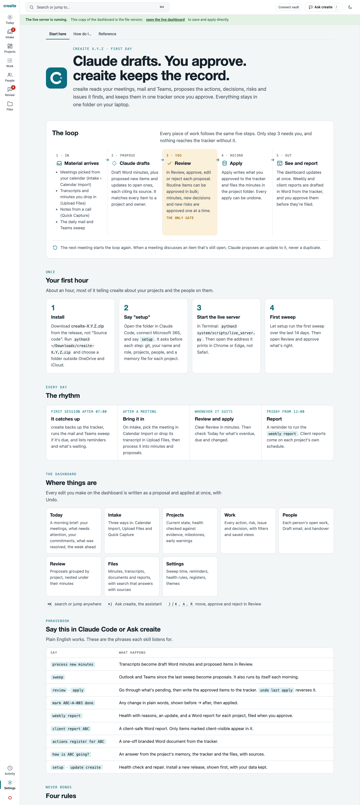
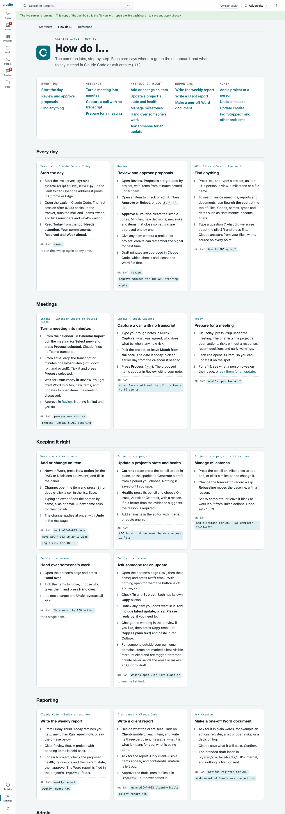

# Merge notes: Help in three tabs (BL-84)

Branch `sprint-help`. Merges **after** `sprint-draft-email`; expect a conflict in `help.md`. Take this sprint's structure and keep Draft email's wording where it is more exact (People in Reference, the Draft email card, the People line under Where things are).

## Screenshots against the published artifacts

Start here and How do I… in creaite standard, light, at 1300px, from the dashboard (the published artifacts are the visual spec). Fonts are the system fallback: the three font files could not be downloaded in this session (see Hand-offs in `help.md`), so letterforms differ from the artifacts until `fetch_help_fonts.py` has been run. Layout, spacing, colours and components match.

The eyebrow reads "creaite X.Y.Z" in these shots only because the throwaway test vault has no `VERSION` file; a real vault shows its version.

## Differences from the artifacts, on purpose

- Draft email replaces Prep 1:1: "Prepare for a meeting" is now Today's Prep only, and a new card, "Ask someone for an update", describes Draft email (18 tasks, not 17).
- The People line under Where things are says "Draft email, and handover".
- The eyebrow shows the installed version in full ("creaite 1.0.0 · first day"), and the install step uses it, so the guides don't go stale.
- Anchors are the task title in lower case with hyphens (`#hand-over-someones-work`), not the artifacts' short ids.
- Under a theme other than creaite standard, the text in the amber "You" panel uses the theme's ink (its muted colour was under 4.5:1 there).
