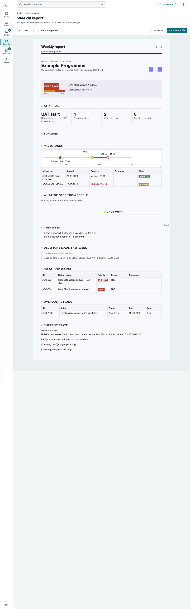
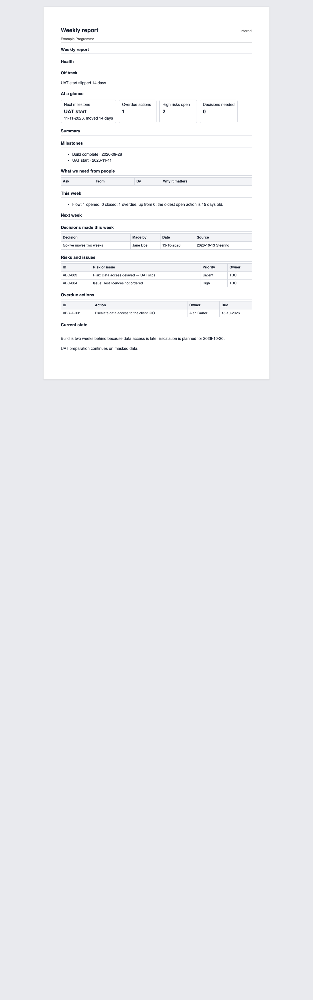
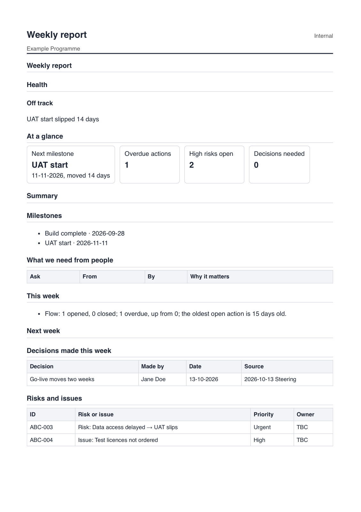

# Weekly report export audit (18-10-2026)

Question: are the HTML, Word and PDF exports faithful to the weekly report as edited? Read-only audit; nothing in the product was changed.

**Answer: no.** The on-screen sheet (Show as exported) is drawn by the dashboard's Preact components (`system/templates/dashboard/src/components/report/weekly/*.jsx`). All three exports are drawn by a second, separate Python renderer (`creaite_doc.py`), which knows five section types and none of the weekly report's richer drawing. The PDF is the HTML export printed by Chrome, so HTML and PDF are identical to each other; Word is a third rendering through the firm template.

## Method

- Throwaway vault from the test fixtures (`test_weekly_report_view.WeeklyReportView`, the sample portfolio's Example Programme project, fictional data), real live server and real headless Chrome (`dev/tools/cdp.py`), one browser.
- Opened `#weekly=ABC`, pressed Show as exported, saved the draft, then called `/api/report/export` for `html`, `docx` and `pdf` (the same call the Export menu makes).
- Compared section by section. Chrome rendered the HTML and the PDF (page 1 printed to an image). **LibreOffice is not installed**, so Word was looked at through macOS Quick Look (first page only) and otherwise judged from the code (`creaite_doc.word_export`) and the fill it drives; Word findings marked (code) were not seen on a rendered page.
- The weekly report held every kind of content: header with logos, health with flag and six-week strip, At a glance, milestone timeline and list, tables (asks, decisions, risks, overdue), text sections (this week, summary, next week), Current state with an image line.

Screenshots (small, in `export-audit/`):

- On screen, Show as exported: 
- The exported HTML opened on its own: 
- The PDF, page 1 printed to an image: 

## Section by format

"Lost" means present on screen in Show as exported and absent or changed in the export. PDF equals HTML apart from pagination (`section{break-inside:avoid-page}`, so a section moves whole to the next page; in this run the PDF broke after Risks and issues).

| Section | HTML export | Word export | PDF export |
|---|---|---|---|
| Header | Loses logos, the "Weekly report · Internal" eyebrow, the big project name and the "Week ending Friday 16 October 2026 · for client" line. Adds a plain title band, then an extra section titled "Weekly report" with nothing under it (duplicate title, empty heading) | Title block comes from the template (project, "Weekly Report", status line, week ending); firm logo is the template's, not the report's chosen logos (code). Also gets the empty "WEEKLY REPORT" heading. Client name line dropped | As HTML |
| Health | Loses the coloured flag block, the six-week strip with its dates and "Last week: At risk (09-10)". Keeps the flag as a bold word and the reason | Keeps a coloured label (OFF TRACK) then the word again ("OFF TRACK Off track"), then the reason. Loses the strip and "Last week" | As HTML (flag is a plain bold word, no colour) |
| At a glance | Boxes kept, but different style, left-aligned, no red for overdue, wraps differently | Boxes become four "Label: value" lines | As HTML |
| Summary / Next week (empty text) | Heading with nothing under it (screen also shows the heading, so equal; neither shows a placeholder) | Heading with nothing under it | As HTML |
| Milestones | Loses the timeline picture (today marker, slip line, month ticks) and the table (Agreed, Expected with "+14", Progress, State chip). Replaced by a bullet list of name and one date in ISO form (`2026-09-28`, `2026-11-11`), the forecast date only; the agreed date is lost; a done milestone shows its forecast, not "achieved". The list breaks the DD-MM-YYYY rule | Same bullet list with ISO dates; no picture, no table | As HTML |
| What we need from people (empty) | Empty table: header row only. Screen says "Nothing is needed from anyone this week." | Header-only table (seen) | As HTML |
| This week | Equal (bullet list) | Equal | Equal |
| Decisions | Screen: quoted line plus "Made by … on … Source …". Export: a four-column table (content kept, form changed) | Table, white-on-black header (template style) | As HTML |
| Risks and issues | Loses the Response column and the coloured priority chips (URGENT, HIGH); priority is plain text | Same: no Response column, no chips (priority plain text) | As HTML |
| Overdue actions | Loses the Late column ("1 day" in red) | Same | As HTML |
| Current state | Pane title printed as an empty `<h3>`. Image lines dropped silently (screen shows them as raw `` text; neither draws a picture) | Text only; image markdown handling not checked on a rendered page (code: passed to the Markdown fill as text) | As HTML |
| Section headings | Plain bold with a rule; the screen's accent square and capitals are lost | Capitals with an accent rule (template style), differs from both | As HTML |
| Page frame | A4 card on grey; no page footer or "Page n" | Template page frame | A4, `@page` margin 16 mm, no header or footer |
| Tags, eyes, counts | Correctly absent | Correctly absent | Correctly absent |
| Hidden sections and rows | Correctly absent (`creaite_doc.clean`) | Correctly absent | Correctly absent |

Ten things worth fixing, in order of how likely Alan sees them: no timeline picture; no flag block or six-week strip; no logos; duplicate title and an empty "Weekly report" section; ISO dates in the milestone list; lost table columns (Response, Late, chips); empty heading and empty table shells; the milestone table's agreed and expected dates; Word's doubled flag; empty `<h3>` in Current state.

## Root causes

| Loss | Cause (file: function) |
|---|---|
| The exports are a second renderer | `creaite_doc.py`: `render`, `section_html`, `_table`, `_figures`, `_panes`, `_health`, `_timeline` (HTML, with its own `CSS` string) against the dashboard's `components/report/weekly/*.jsx` and the sheet's stylesheet; `creaite_doc.word_export` and `_word_entries` for Word. Nothing shares code |
| Header duplicate and empty section | `section_html` renders every shown section as `<h2>` plus body; the `header` section has type `header` (unknown, so "text only") with empty text, so it prints its heading "Weekly report" under `render`'s own title band. Word: `_word_body` does the same with the template's heading style |
| No logos | `render` never reads `section.data.logos` or the logo files (`report_doc.logos`, served to the page by `report_server.draft_route`) |
| No flag block or strip | `_health` prints only `data.flag` and the text; `data.trend` is never read. Word: `_health_entries` uses the fill's `flag` label then adds the text, hence the doubled word |
| No timeline picture | The picture is an SVG built in the browser (`Timeline.jsx: Drawing`); no Python equivalent exists. `_timeline` and `_timeline_entries` only list `data.milestones` |
| ISO dates, forecast only | `report_doc.item` stores `due_date = forecast_date or baseline_date` for a milestone; `_timeline` and `_timeline_entries` print it unformatted |
| Table columns Response and Late, chips | Those columns are computed in the browser from the item (`Tables.jsx`: `response_action`, `daysLate`); a table section's data holds only the declared columns. `_table` and `_word_table` print `cells` as plain text |
| Empty tables and headings | No empty-section rule: `section_html` prints the heading and an empty `<table>` shell; the screen shows an "empty" sentence instead (`Tables.jsx: EyeTable`) |
| Empty `<h3>` | `_panes` prints the pane title even when empty |
| Dropped images | `md_html` goes through `prep_page.md_blocks`/`blocks_html`, which keep text only and drop image links ("links keep their text only") |
| PDF follows HTML | `creaite_doc._make_export` (pdf branch) writes the same `render(doc, editing=False)` to a temporary page, then `print_pdf` (headless Chrome, `--print-to-pdf`). Honest to HTML by design; no extra loss |
| Word pagination, table style | The firm's template (`system/templates/weekly-report-template.docx`, `dev/tools/build_templates.py`) and `docx_tools.adhoc_table`; Word has no notion of the sheet's cards |

## Is one renderer for HTML and PDF feasible?

**Yes.** The PDF already prints the export HTML, so a single new HTML is a single change. Two ways:

- **A. Port the missing drawing to Python** (flag block, strip, timeline SVG, logos as data URIs, column set, date format, empty-section rule). Keeps the CLI and scheduled paths (`creaite_doc.export`, minutes, cx skills) working with no browser, but keeps two renderers that drift again. About 3 to 4 Sonnet-agent days, plus the same again every time a component changes.
- **B (recommended). Make the sheet's own exported mode the renderer.** The dashboard already draws Show as exported from the same document; export would take that DOM (cleaned: no scripts, no `data-*` hooks, the dashboard's sheet CSS inlined, logos as data URIs), save it as the HTML export, and print that same page for the PDF. Two ways to get the DOM: the browser serialises it and posts it to `/api/report/export` (token-checked, the live server's own origin), or the server launches the same headless Chrome it already uses for the PDF against a small print route that draws the sheet in exported mode (`--dump-dom`). Keep `creaite_doc.render` as the fallback when no live server or Chrome is available, and for minutes until they are moved too.

Effort for B, in Sonnet-agent days: sheet export-mode serialiser and a self-contained stylesheet (1.5); `report_server.export_route`/`creaite_doc._make_export` take the HTML, sanitise it with an allow-list and keep the existing gates (client check, baseline, no hidden content: verify the serialised text against `creaite_doc.clean`) (1.5); print CSS for A4 and pagination, colour printing (1); rewrite `test_report_exports.py`, `test_report_banner.py` and hand check 16/74 expectations (1); client report and minutes parity pass (1). **About 5 to 6 days**, one agent, with a short review.

Files and the guarded list: `report_server.py`, `report.py`, `creaite_doc.py`, `report_doc.py`, `docx_tools.py` and the dashboard sources are **not guarded**; the guarded files in the brief (`tracker.py`, `filechange.py`, `live_server.py`, `reach.py`, `permissions.py`, `backup.py`, `update.py`) need no edit if the print route is added in `report_server.py` (routes are registered there: `live_server.py` line `DRAFT_ROUTES.update(report_server.routes(...))`). Filing still goes through `filechange.py` as today. Only if a new route had to be wired in `live_server.py` itself would it become a guarded change (routes only, as BL-342 did).

Risks: (1) a client or a hidden item reaching an export if the serialised DOM is trusted: the server must re-check against `clean` and the leak findings (`client_leak`) before writing, and a client report must be exported only from the locked data; (2) the sheet's CSS is large and tied to the dashboard's theme tokens, so the export needs a fixed light print theme; (3) browser-dependent output (the CLI and cx skills have no page, so the Python fallback stays and can drift); (4) the exported HTML grows (inlined CSS, images); (5) the Settings "file beside" and `(read only)` naming and test expectations change.

## Word: HTML to docx, or a separate writer?

- **HTML to docx: not recommended.** `system/scripts/vendor/` has no converter (only jinja2, openpyxl, pypdf and friends); a new vendored library is needed (runtime never pip installs), it ignores the firm's template styles, and a card or SVG does not become native Word. About 5 or more days for a worse result than the current writer.
- **Keep the separate writer and close the gaps (recommended).** `docx_tools` already fills images (`{"image": …}` entries). Use that: draw the timeline and the health strip as PNGs (screenshot of the same exported sheet's SVG, so they match the screen), insert the logos, render milestones and risks as tables with all columns, dedupe the title and the doubled flag word, format dates DD-MM-YYYY, skip empty sections and drop empty table shells. About 3 to 4 Sonnet-agent days, all in non-guarded files (`creaite_doc.py`, `docx_tools.py`, `dev/tools/build_templates.py` if the template needs a style). Risk: Word rendering is not testable here without LibreOffice (or Word); the tests check the XML only. Add LibreOffice to the Brewfile for development, or accept hand checks on the laptop.

## Not covered

Pages after the first of the Word and PDF files were not rendered (Quick Look and the PNG show page 1); their content was read from the HTML and the code. The client report and minutes exports use the same code and are likely to show the same kinds of loss, but were not run.
